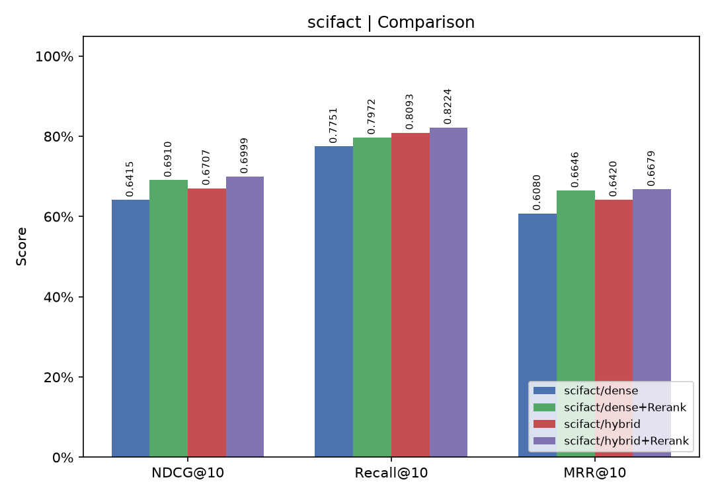

# RAG Memory Platform

面向 AI 应用的多租户记忆服务，同时保留了最初的 RAG 检索与评测能力（见文末 **旧版 RAG 服务**）。

- **多租户**：`tenant → project → api_key` 三级隔离，服务端强制按租户/项目过滤，跨租户访问返回 404。
- **控制面 / 数据面分离**：JWT 管理项目与 API Key；API Key（`sk_live_<prefix>_<secret>`，HMAC-SHA256 存储）调用记忆接口，按 scope 授权。
- **异步索引**：写入先落 PostgreSQL + outbox，Relay 投递到 Kafka，worker 消费后写 Qdrant，at-least-once + 幂等消费。
- **可靠性与限流**：HTTP 幂等键（命中重放首次响应）、Redis Lua 令牌桶限流、月度配额、用量账本与对账。
- **可观测性**：Prometheus 指标（含 trace exemplar）、Grafana 看板、Alertmanager 告警、OpenTelemetry 链路、日志携带 trace_id。

## 架构

```
client / SDK
    │  Bearer JWT（控制面） / Bearer API Key（数据面）
    ▼
FastAPI api ──► PostgreSQL（租户/项目/Key/记忆/outbox/usage）
    │              │
    │              └──► outbox relay ──► Kafka ──► worker ──► Qdrant
    ▼
Redis（Key 缓存、限流、配额、幂等、last_used、用量缓冲）
    │
    └──► observability：Prometheus → Alertmanager / Grafana；OTLP → Jaeger
```

## 目录结构

- `app/` - API 路由、鉴权依赖、请求上下文与指标中间件
- `security/` - API Key 生成/校验、JWT、argon2 密码
- `infrastructure/db/` - SQLAlchemy 模型、仓库、引擎；`migrations/` 为 Alembic 迁移
- `infrastructure/cache/` - Redis 限流、配额、幂等、用量缓冲/落账、last_used 回写
- `infrastructure/queue/` - outbox relay、Kafka 生产/消费、重试与 DLQ
- `infrastructure/vector/` - Qdrant 记忆索引
- `infrastructure/observability/` - 指标、链路、积压采集
- `worker/` - Relay + Consumer 后台进程（同时暴露 `/metrics`）
- `sdk/` - 异步 Python 客户端
- `observability/` - Prometheus 抓取/告警规则、Alertmanager、Grafana 数据源与看板
- `deploy/k8s/` - Kubernetes 部署清单
- `scripts/` - `smoke.py` 端到端自检、`loadtest.py` 压测
- `engine/`、`embedding/`、`rerank/`、`eval/`、`vector_store/`、`routes/`、`main.py`、`mcp_server.py` - 旧版 RAG 能力（仍可用，见文末）

## 快速开始（Docker Compose）

```bash
docker compose up -d --build          # api、worker、postgres、redis、qdrant、kafka、迁移
docker compose --profile models up -d # 可选：本地 embedding/rerank（需 GPU 与 models/ 下的模型）
```

`migrate` 服务会在 api 启动前自动执行 `alembic upgrade head`。没有启动 embedding 服务时，新记忆会停留在 `pending`，不会完成索引。

| 服务 | 地址 | 说明 |
| --- | --- | --- |
| API | http://localhost:8001 | `/docs` 查看 OpenAPI |
| Prometheus | http://localhost:9090 | 告警状态见 `/alerts` |
| Alertmanager | http://localhost:9093 | 分组、抑制、静默 |
| Grafana | http://localhost:3000 | admin/admin，看板在 `RAG` 目录 |
| Jaeger | http://localhost:16686 | trace 查询，服务名 `rag-api` / `rag-worker` |
| Embedding / Rerank | 8002 / 8003 | 需 `models` profile |
| Qdrant / Kafka / Redis / PostgreSQL | 6333 / 9092 / 6379 / 5432 | |

## API 一览

| 方法 | 路径 | 鉴权 | 说明 |
| --- | --- | --- | --- |
| POST | `/v1/auth/register` | 无 | 注册用户 + 租户 + 默认项目 |
| POST | `/v1/auth/login` | 无 | 获取 JWT |
| GET | `/v1/me` | JWT | 当前用户 |
| GET/POST | `/v1/projects` | JWT | 项目列表 / 新建（owner、admin） |
| POST/GET/DELETE | `/v1/api-keys` | JWT | 创建（返回一次明文 Key）/ 列表 / 吊销 |
| POST | `/v1/memories` | API Key `memories:write` | 支持 `Idempotency-Key`，命中时重放首次响应 |
| GET | `/v1/memories` | API Key `memories:read` | `limit` / `offset` 分页 |
| POST | `/v1/memories/search` | API Key `memories:read` | 语义检索 `query` / `top_k` |
| GET/PATCH/DELETE | `/v1/memories/{id}` | API Key | 读取 / 更新（重新索引）/ 软删除 |
| GET | `/v1/usage`、`/v1/usage/events`、`/v1/usage/reconcile` | JWT | 用量聚合、明细、Redis 与账本对账 |
| GET | `/health/live`、`/health/ready` | 无 | 存活 / 就绪（依赖未初始化时 503） |
| GET | `/metrics` | 无 | Prometheus/OpenMetrics，建议只在集群内暴露 |

## SDK

```python
import asyncio
from rag.sdk import RagClient

async def main() -> None:
    async with RagClient("http://localhost:8001") as client:
        reg = await client.register("dev@example.com", "secret123", "Acme")
        key = await client.create_api_key(
            reg["project_id"], "backend", ["memories:read", "memories:write"]
        )
        client.api_key, client.token = key["key"], None

        memory = await client.create_memory(
            "用户偏好深色主题", idempotency_key="pref-1"
        )
        hits = await client.search_memories("主题偏好", top_k=3)
        print(memory["id"], len(hits))

asyncio.run(main())
```

失败时抛出 `ApiError`，带 `status_code`、`detail`、`request_id`、`trace_id`。

## 可观测性

- 指标：`http_requests_total` / `http_request_duration_seconds`（含 `tenant` 标签与 trace exemplar）、限流/配额拒绝、鉴权失败、outbox 积压与最老等待时长、记忆按状态计数。
- 租户标签默认折叠为 `other`；需要按租户拆分时设置 `METRICS_TENANT_ALLOWLIST=<id1>,<id2>`（白名单控制基数）。
- 链路：设置 `OTEL_EXPORTER_OTLP_ENDPOINT=http://jaeger:4318` 启用；响应头返回 `X-Trace-Id`，日志每行包含 trace_id。
- 告警：API 5xx 比例 / P95 / 鉴权失败突增，outbox 积压与投递失败、用量落账失败、pending 记忆过多；Alertmanager 对同 job 做告警抑制，接收器默认为空，需按 `observability/alertmanager.yml` 注释接入 webhook。

## 测试与压测

```bash
source .venv/bin/activate
PYTHONPATH=.. python -m pytest -q     # 单元/契约测试（不需要外部服务）
ruff check .

python scripts/smoke.py               # 对运行中的 API 跑完整流程
python scripts/loadtest.py --requests 200 --concurrency 20
```

等价的 `make test` / `make smoke` / `make loadtest` 也已配置。

## 部署

- Docker Compose 见上；镜像为 `Dockerfile`（API/worker）与 `Dockerfile.models`（embedding/rerank）。国内网络可用 `docker compose build --build-arg PIP_INDEX_URL=https://mirrors.aliyun.com/pypi/simple/` 加速依赖安装。
- Kubernetes：`kubectl apply -f deploy/k8s/app.yaml`。先等待 `rag-migrate` Job 完成；worker 可水平扩展（usage flush 已原子取批、消费按 group 分摊），多副本时指标需按 Pod 抓取；配置与 Secret 需替换为真实值。

## 旧版 RAG 服务（Legacy）

> 以下描述改造前的单租户 RAG 与评测能力，代码仍在仓库中，旧路由挂载在 `/legacy` 下。

### 快速开始（旧）

> 以下命令均在**项目根目录**下执行（项目根目录即 `rag` 包的根，`main.py`、`scripts/`、`eval/` 等都在此目录下）。

#### 1. 安装依赖

```bash
python -m venv .venv
source .venv/bin/activate
pip install -e .
```

> 项目依赖定义在 `pyproject.toml`，包括 `fastapi`、`qdrant-client`、`httpx`、`beir`、`matplotlib`，以及多模态所需的 `transformers`、`accelerate`、`bitsandbytes`。

#### 2. 启动服务

使用项目自带管理脚本：

```bash
./scripts/run.sh start
```

常用命令：

- `./scripts/run.sh start`：启动全部服务（默认）
- `./scripts/run.sh start api`：仅启动 API 服务及依赖服务（`mcp` / `embedding` / `rerank` / `qdrant` 同理）
- `./scripts/run.sh stop`：停止所有服务；`stop api` 只停止单个服务
- `./scripts/run.sh restart rerank`：重启单个服务；不带参数时重启全部
- `./scripts/run.sh status`：查看各服务 PID、端口与就绪状态
- `./scripts/run.sh logs api`：跟踪单个服务日志（`qdrant` / `embedding` / `rerank` / `mcp` 同理）

#### 3. API 地址

- RAG API: `http://localhost:8001`
- MCP Server: `http://localhost:9000`
- Embedding 服务: `http://localhost:8002`
- Rerank 服务: `http://localhost:8003`

### 使用说明

#### 创建/列出知识库

- 创建 collection：

```bash
curl -X POST http://localhost:8001/knowledge \
  -H "Content-Type: application/json" \
  -d '{"name":"scifact","enabled":true,"hybrid":true}'
```

> `hybrid` 需要 embedding 后端产出稀疏向量（BGE-M3）。当前默认的 Qwen3-VL 多模态后端不产稀疏向量，`hybrid` 会静默退化为纯 dense；此时该字段填 `true` 或 `false` 效果相同。

- 列出 collection：

```bash
curl http://localhost:8001/knowledge
```

> 每个 collection 在 metadata 中记录 `embedding_id`（`conf/conf.yaml` 顶层 `embedding.id`）。
> 启动时只有 id 与当前配置一致、且维度匹配的集合会标记为 active；其余标记为 inactive，
> 不阻断服务启动。`GET /knowledge?include_inactive=true` 可查看未激活原因。

#### 导入文档 / BEIR 数据集

直接调用导入脚本（`rag` 包即项目根目录本身，`python -m rag.*` 需在项目根下把**上一级**目录加入搜索路径）：

```bash
source .venv/bin/activate
PYTHONPATH=.. python -m rag.eval.ingest <source-path> -c <collection>
```

导入 BEIR 数据集：

```bash
python -m rag.eval.ingest --dataset-name scifact -c scifact
```

#### 检索查询

发送 search 请求：

```bash
curl -X POST http://localhost:8001/knowledge/search \
  -H "Content-Type: application/json" \
  -d '{
    "collection": "scifact",
    "queries": ["your query text"],
    "top_k": 10,
    "threshold": 0.0,
    "search_type": "dense",
    "rerank": false
  }'
```

### 多模态

Embedding 与 Rerank 服务均支持文本与图片映射到**同一向量空间**，因此文本查询可以检索图片。开关在 `conf/conf.yaml`：

```yaml
embedding:
  model: "models/Qwen3-VL-Embedding-2B"
  multimodal: true        # true=Qwen3-VL-Embedding（多模态）；false=BGE-M3（纯文本 + 稀疏）
rerank:
  model: "models/Qwen3-VL-Reranker-2B"
  multimodal: true        # true=Qwen3-VL-Reranker（多模态）；false=ms-marco（纯文本）
```

两个模型均以 **int8 量化**加载，显存占用约为 fp16 的一半。模型文件需预先放在 `models/` 下。

> **注意**：Qwen3-VL-Embedding **不产出稀疏向量**，因此多模态后端下 `hybrid` 会静默退化为纯 dense 检索（不报错）。需要稀疏检索时请把 embedding 切回 `BGE-M3`（`multimodal: false`）。切换模型后向量维度会变化（Qwen3-VL 为 2048，BGE-M3 为 1024），需重建 collection。

#### 导入图片

`/knowledge/ingest` 的 `documents` 为多态数组，文本与图片可混在一起：

```bash
curl -X POST http://localhost:8001/knowledge/ingest \
  -H "Content-Type: application/json" \
  -d '{
    "collection": "mm",
    "documents": [
      {"type": "text",  "content": "一只在草地上奔跑的狗", "metadata": {"doc_id": "t1"}},
      {"type": "image", "url":  "https://example.com/dog.jpg", "metadata": {"doc_id": "i1"}},
      {"type": "image", "path": "/data/imgs/cat.png", "metadata": {"doc_id": "i2"}}
    ]
  }'
```

- `type` 为判别字段，**必须显式给出**（`"text"` 或 `"image"`）。
- 图片的 `url` 与 `path` **必须且仅有一个**非空；`path` 为**服务端本机**可读路径。
- 分块（`chunk_size` / `chunker_type`）**仅作用于文本文档**，图片始终整条入库、不切分。

#### 检索（含图片结果）

`queries` 目前为纯文本列表（图片作为**检索结果**返回，暂不支持以图搜图）：

```bash
curl -X POST http://localhost:8001/knowledge/search \
  -H "Content-Type: application/json" \
  -d '{
    "collection": "mm",
    "queries": ["a dog running on grass"],
    "top_k": 5,
    "rerank": true
  }'
```

返回的 `payload` 同样是多态对象，图片结果形如 `{"type": "image", "url": "...", "metadata": {...}}`。

多模态 rerank 的分组约定：每个 query 的候选按**文本在前、图片在后**拼接，返回的分数与这个顺序一一对应。

### 评测

项目基于 [BEIR](https://github.com/beir-cellar/beir) 评测流程。示例（在项目根目录下）：

```bash
source .venv/bin/activate
PYTHONPATH=.. python -m rag.eval eval --dataset-name scifact --collection scifact
```

这会生成 JSON 报告文件到 `data/`，默认文件名类似：

- `scifact_scifact_dense_no_rerank_<timestamp>.json`
- `scifact_scifact_dense_rerank_<timestamp>.json`
- `scifact_scifact_hybrid_no_rerank_<timestamp>.json`
- `scifact_scifact_hybrid_rerank_<timestamp>.json`

#### 绘图

评测完成后，可使用 plot 功能生成对比图：

```bash
source .venv/bin/activate
PYTHONPATH=.. python -m rag.eval plot data/<report1>.json data/<report2>.json ...
```

生成的 PNG 文件会保存到 `data/`。

#### 评测结果（SciFact，300 查询 / 5183 文档）

> ⚠️ 下表为 **2026-07-29 的旧结果**，当时使用 BGE-M3（embedding）+ ms-marco-MiniLM-L6-v2（rerank）纯文本后端。切换至 Qwen3-VL 多模态模型后**尚未重新评测**，数值不可直接对应当前默认配置；下表仅作为历史基线与流程示例。

各检索配置在 SciFact 数据集上的指标：

| 配置 | NDCG@1 | NDCG@10 | MAP@10 | Recall@10 | MRR@10 | NDCG@100 | Recall@100 |
| --- | ---: | ---: | ---: | ---: | ---: | ---: | ---: |
| dense（无重排） | 0.5100 | 0.6415 | 0.5920 | 0.7751 | 0.6080 | 0.6706 | 0.9037 |
| dense + rerank | 0.5633 | 0.6910 | 0.6508 | 0.7972 | 0.6646 | 0.7141 | 0.9137 |
| hybrid（无重排） | 0.5100 | 0.6707 | 0.6200 | 0.8093 | 0.6420 | 0.6991 | 0.9303 |
| hybrid + rerank | 0.5667 | 0.6999 | 0.6547 | 0.8224 | 0.6679 | 0.7136 | 0.9270 |

检索对比图：



> 小结：rerank 明显提升 precision 类指标（NDCG@1 / MAP@1）；hybrid 在召回率（Recall@10 / Recall@100）上优于纯 dense。

#### 评测结果（LiHua-World 端到端评测，Agent 多轮检索）

除单次检索的 BEIR 式评测外，项目还实现了 **LLM-Agent 驱动的端到端检索评测**（`eval/lihua/`），验证"LLM 自主规划查询 → 调用 RAG MCP 工具 → 多轮收敛 → 生成答案"的完整链路。

**评测场景（LiHua-World）**：基于公开 [LiHua-World](https://github.com/HKUDS/MiniRAG/tree/main/dataset/LiHua-World) 数据集的**长上下文时序型**检索场景——442 段通讯对话覆盖 52 周时间线（含业务往来、生活备忘等多主题），问题需跨会话、跨时间定位证据。query_set 全量 637 题按证据类型分布：

| 类型 | 题数 | 说明 |
| --- | ---: | --- |
| Single | 506 | 证据在同一段会话内 |
| Multi | 66 | 需跨多段会话拼接证据 |
| Null | 65 | 知识库无答案，应拒答 |

> 数据集为公开语料（[HKUDS/MiniRAG](https://github.com/HKUDS/MiniRAG)，ACL 2026），不随仓库分发。运行评测前请将 `processed.jsonl`、`query_set.json` 及会话 txt 放置到 `eval/lihua/dataset/`（含 `week*/` 等子目录），目录结构见 `eval/lihua/dataset.py` 顶部说明。

**评测方式**：Agent 模式由 LLM 自主决定查询策略（改写/拆解/追问）并循环调用 MCP `search` 工具，证据覆盖后自行收敛输出答案，再由 LLM 从五个维度打 1-5 分；Direct 模式为对照基线（问题原样单次检索 top-5，不产答案）。**本次评测仅跑 query_set 全量 637 题的 1/10 抽样子集（seed=42、ratio=0.1，共 64 题）**，agent 与基线用**同一 64 题子集**保证可比；以下 Agent 结果均基于该 1/10 子集，不代表全量结论。

**运行命令**（项目根目录下，需先启动服务）：

```bash
source .venv/bin/activate
# Agent 多轮检索评测（可 --qids 0,1.. / --types Multi / --max-rounds 调整）
PYTHONPATH=.. python -m rag.eval.lihua -c lihua --mode agent \
  --sample-ratio 0.1 --sample-seed 42 --output lihua_agent_sample01
# Direct 基线（同题集对照）
PYTHONPATH=.. python -m rag.eval.lihua -c lihua --mode direct \
  --top-k 5 --output lihua_direct_top5
```

**检索结果（Agent vs Direct 基线，同一 64 题子集 = query_set 全量的 1/10）**：

| 指标 | Direct（单轮 top-5） | Agent（多轮） |
| --- | ---: | ---: |
| 证据累积召回率 | 76.72% | **88.36%** |
| 首轮召回率 | 76.72% | 79.31% |
| 全题证据召齐全率（full recall rate） | 65.62% | **78.12%** |
| 平均检索轮次 | 1.0 | 2.34 |
| 平均查询数 | 1.0 | 9.69 |
| 冗余调用/题 | 0 | 0.20 |
| 错误率 | 0% | 0% |

Agent 通过多轮检索把证据累积召回率从基线的 76.7% 提升到 **88.4%（+11.7pp）**，全题召齐全率提升 **12.5pp**；平均仅需 2.3 轮即收敛，冗余调用接近 0。（以上均为 1/10 抽样子集 64 题上的结果）

**LLM 五维裁判评分（1-5，Agent 模式，1/10 子集 64 题）**：

| 维度 | 均分 |
| --- | ---: |
| answer_correctness（答案正确性） | 3.84 |
| evidence_recall（证据覆盖） | 4.53 |
| groundedness（回答有据性） | 4.23 |
| query_quality（查询质量） | 3.73 |
| retrieval_efficiency（检索效率） | 3.00 |
| **overall mean** | **3.87** |

**拒答（abstention，1/10 子集 64 题内）**：整体 abstain 率 29.7%，其中 Null 类（知识库无答案）问题全部正确拒答，可有效降低幻觉风险。

原始轨迹与报告见 `eval/lihua/results/`：

- `lihua_agent_sample01_report.json` / `.jsonl` — Agent 1/10 抽样 64 题评测报告与逐题轨迹
- `lihua_direct_top5_report.json` — Direct 全量 637 题基线报告（非 1/10 抽样，仅作语料整体基线参考）
- `lihua_direct_top5_sample01_agg.json` — 同 1/10 子集（64 题）Direct 对照聚合，用于与 Agent 逐项对比

### 运行环境

- Python 3.11+
- Qdrant (通过 Docker 启动)
- 本地模型文件存放在 `models/`，多模态模式需 `Qwen3-VL-Embedding-2B` 与 `Qwen3-VL-Reranker-2B`
- 多模态模型以 int8 量化加载，需 `bitsandbytes` 与 CUDA GPU（CPU 下可运行但极慢）

### 注意事项

- `python -m rag.*` 入口需要 `rag` 包可被 Python 找到：项目根目录即 `rag` 包本身，故需在项目根目录下运行并把**上一级**目录加入搜索路径（`PYTHONPATH=..`）。完成 `pip install -e .` 后包已注册到虚拟环境，可省略该设置。
- Qdrant collection 在服务端实际存储时使用命名空间前缀，例如 `KnowledgeBase.scifact`。
- 如果在 `ingest` 时出现 404 或 `collection doesn't exist`，可能是 RAG 服务内存状态与 Qdrant 实际状态不同步，建议重启 RAG 服务后重新导入。
- **切换 embedding 模型（BGE-M3 ↔ Qwen3-VL）会改变向量维度**（1024 ↔ 2048），已有 collection 会因维度不匹配导致服务启动失败，需删除并重建。
- 多模态 embedding 后端下 `hybrid` 无效（不产稀疏向量），会静默退化为纯 dense。

### 开发

项目已配置 `README.md` 为 `pyproject.toml` 的默认 README 文件。可通过 `pytest` 执行开发测试，`ruff` 进行静态检查。

```bash
source .venv/bin/activate
pytest
ruff check .
```
